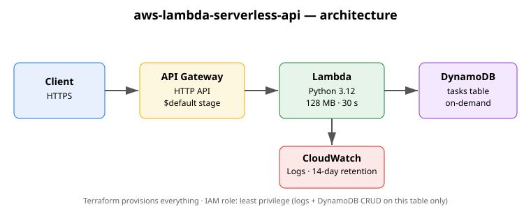

# aws-lambda-serverless-api

A serverless REST API for managing tasks, built on **AWS Lambda + API Gateway (HTTP API) + DynamoDB**, provisioned entirely with **Terraform**, with **GitHub Actions CI** (lint, unit tests, `terraform fmt`/`validate`).



## Architecture

```
Client ──HTTPS──▶ API Gateway (HTTP API) ──▶ Lambda (Python 3.12) ──▶ DynamoDB (on-demand)
                                                        │
                                                        ▼
                                                  CloudWatch Logs
```

- **API Gateway HTTP API** — single `$default` stage with auto-deploy; cheaper and simpler than REST API for proxy integrations.
- **Lambda** — one function, payload format 2.0, 128 MB / 30 s timeout, least-privilege IAM role (CloudWatch Logs write + DynamoDB CRUD on this table only).
- **DynamoDB** — on-demand table `tasks-api-dev`, partition key `id`.
- **CloudWatch** — dedicated log groups for Lambda and API Gateway access logs, 14-day retention.

## API reference

| Method | Path          | Description              | Body / Response                          |
|--------|---------------|--------------------------|------------------------------------------|
| GET    | `/health`     | Health check             | `{"status":"ok","service":"tasks-api"}`  |
| GET    | `/tasks`      | List tasks (max 50)      | `{"tasks":[...]}`                        |
| POST   | `/tasks`      | Create a task            | `{"title":"..."}` → `201` with the item  |
| GET    | `/tasks/{id}` | Get one task             | `200` with the item, `404` if missing    |
| DELETE | `/tasks/{id}` | Delete a task            | `204`, `404` if missing                  |

Example:

```bash
BASE=$(terraform -chdir=terraform output -raw api_endpoint)

curl -s -X POST "$BASE/tasks" \
  -H 'Content-Type: application/json' \
  -d '{"title":"Write README"}' | jq .

curl -s "$BASE/tasks" | jq .
```

## Prerequisites

- AWS account with credentials configured (`aws configure`)
- Terraform >= 1.9
- Python 3.12 (for running tests locally)

## Deploy

```bash
cd terraform
terraform init
terraform plan        # review before applying
terraform apply
```

After apply, the API base URL is printed as `api_endpoint`.

## Test locally

```bash
pip install -r src/requirements.txt pytest ruff
ruff check src tests
pytest tests -v
```

Tests fake DynamoDB with `unittest.mock` — no AWS credentials needed.

## Cost (AWS Free Tier)

Designed to stay inside the AWS Free Tier:

- **Lambda** — 1M free requests + 400,000 GB-seconds/month (12 months)
- **API Gateway HTTP API** — 1M free requests/month (12 months)
- **DynamoDB** — 25 GB storage free (always); on-demand requests for a demo workload are negligible
- **CloudWatch Logs** — 5 GB ingestion free (always); 14-day retention keeps storage tiny

Tear everything down when done:

```bash
terraform -chdir=terraform destroy
```

## Project layout

```
├── src/                 # Lambda function source
│   ├── handler.py       # request router + DynamoDB operations
│   └── requirements.txt # boto3 (also present in the Lambda runtime)
├── tests/               # pytest unit tests (mocked DynamoDB)
├── terraform/           # versions, provider, variables, infra, outputs
├── docs/architecture.svg
└── .github/workflows/ci.yml
```

## Limitations

- `GET /tasks` uses a `Scan` capped at 50 items — fine for a demo, not for large tables (use Query + pagination in production).
- No authentication — add a Lambda authorizer or Cognito before exposing real data.
- Single region, single environment (`dev` by default; override with `-var environment=prod`).
